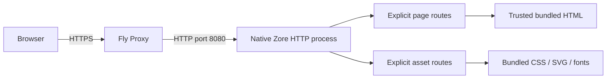

# Zore website: standalone application plan

Status: implementation approved on 2026-10-29. The standalone Zore application, seven pages, monitoring endpoints, container and CI/deployment workflows are implemented. Local native/container/browser checks pass. Hosted CI and temporary-host deployment are being completed; zore.dev DNS and external monitor setup remain pending.

## 1. Goal and decisions

Build the public Zore homepage and essential documentation as an independent Zore application deployed on Fly.io. A visitor should understand the language, install the alpha, and run a first program without searching through compiler internals.

| Item | Direction |
| --- | --- |
| Repository | `maasdi/zore-website`, local folder `D:\projectx\zore-website` |
| Language | Website application and HTTP serving written in Zore |
| Compiler | Published `v0.1.0-alpha.1`; never build the compiler from source in website CI |
| Deployment | Native Linux amd64 container on Fly.io, public HTTPS through Fly Proxy |
| External uptime monitoring | UptimeRobot against the public `/uptime` endpoint |
| Audience | Developers evaluating Zore and early adopters learning the supported subset |
| First release | Homepage, installation, first program, language overview, tools overview, status, and documentation navigation |
| Identity | Systems Console adapted to the supplied horizon reference: geometric ZORE wordmark, sunset O, navy hero, indigo accents and light content |
| Content | English, maintained in the website repository, reviewed against the pinned alpha |
| State | Read-only content bundled in the application image; no database or persistent volume |

Confirmed brand: **Zore**, pronounced **zor**. Tagline: **Simple code. Strong guarantees.** The website does not need to explain the source-extension pronunciation.

Approved design: **Systems Console with Horizon**, based on the supplied `zore_concept.png`. Use the [mockup](design/systems-console-horizon.html), [desktop preview](design/systems-console-horizon.png), [mobile preview](design/systems-console-horizon-mobile.png) and [documentation preview](design/systems-console-horizon-docs.png) as the design baseline. [Design notes](design/README.md) describe the retained assets. Unselected concepts and their comparison galleries have been removed.

## 2. Positioning and tone

The selected concept is **Systems Console with a horizon identity**. The supplied reference contributes a warm rising/setting sun over a fine horizon, geometric lettering, indigo actions and light reading surfaces. Preserve the technical code panel, straightforward navigation and honest alpha copy. Use the horizon as a quiet visual motif, not an animated effect.

Lead with understandable behavior: borrowed parameters, explicit errors, deterministic cleanup, native executables. Keep early-alpha status close to the main calls to action. Use short explanations and executable examples. Present language ambitions separately from capabilities verified in the alpha.

Avoid performance superlatives, invented adoption figures, benchmark claims, full-MVP claims, implied stable compatibility, and promises that native application builds need no toolchain. Do not describe the compiler as self-hosted: this alpha uses the Rust bootstrap compiler.

## 3. Reference-led logo adaptation

Use [the supplied reference](design/zore_concept.png) as the visual basis. Review the [adapted website mockup](design/systems-console-horizon.html), [desktop capture](design/systems-console-horizon.png), and [mobile capture](design/systems-console-horizon-mobile.png). The source image remains unchanged.

Recreate the concept as original editable SVG geometry: a warm gradient sun above a thin horizon, used as the O in a geometric ZORE wordmark. The sunset/horizon symbol also stands alone for compact identity use. The wordmark's Z, R and E are vector paths rather than a font dependency.

| Asset | Use |
| --- | --- |
| [Light wordmark](design/logos/horizon-wordmark.svg) | Dark hero and header |
| [Dark wordmark](design/logos/horizon-wordmark-dark.svg) | Light content surfaces |
| [Light horizon symbol](design/logos/horizon-symbol.svg) | Compact identity on dark surfaces |
| [Dark horizon symbol](design/logos/horizon-symbol-dark.svg) | Compact identity on light surfaces |

These reference-based assets are the approved identity direction. Before release, check small-size optical corrections, clear space, monochrome exports and final favicon treatment. Provide a text alternative of Zore for the wordmark; decorative repetitions need not be announced.

## 4. Visual system: Systems Console with Horizon

| Token | Proposed value | Use |
| --- | --- | --- |
| Navy | `#0B1420` | Header and hero background |
| Console surface | `#101C2A` | Source and terminal panel |
| Light ink | `#EDF4FF` | Dark-section headings and primary text |
| Secondary light ink | `#B8C7D9` | Dark-section supporting copy |
| Indigo | `#6554FF` | Main actions, active navigation and light-section links |
| Cyan | `#68DDD3` | Restrained code/terminal emphasis |
| Paper | `#F7FAFF` | Feature, quick-start and documentation backgrounds |
| Dark ink | `#16243A` | Text on light surfaces |
| Structural rules | `#2B3D53` / `#DCE5F2` | Dark/light section dividers |
| Sun | Purple/pink through warm gold | Identity symbol and a small static horizon accent |

Use clean sans-serif type for prose, monospace for source and the custom vector wordmark for identity. The mockup uses system fonts; final typography can use reviewed, self-hosted fonts. The hero features a large wordmark with the tagline below it and a compact code panel alongside. On mobile, stack the introduction before the code panel.

Keep the dark code/terminal treatment from Systems Console. Use a shallow static horizon arc to transition into the lighter feature and quick-start sections. Avoid copying decorative search, community or clipboard controls unless they have real behavior and destinations. The reference image's source-build instructions are replaced by published-alpha installation.

Documentation uses light, calmer reading surfaces with a 248px navigation column, a 65-75 character reading measure and an optional outline on wide displays. No theme switcher is required for this intentional dark-hero/light-content composition.

Retain semantic landmarks, skip links, visible focus, 44px touch targets, keyboard controls, reduced-motion behavior, useful no-JavaScript navigation, and code scrolling confined to its panel. Verify foreground/background contrast, 320px width and 200% zoom. The visual reference does not override accessibility or truthful capability claims.

## 5. Homepage design and copy

### Header and hero

Navigation: horizon wordmark, **Documentation**, **Learn**, **Examples**, **Roadmap**, GitHub and **Get started** where space allows. Use actual internal sections or pinned upstream destinations. On mobile, use an accessible native disclosure or a compact set of ordinary links.

Release marker: **Early alpha · v0.1.0-alpha.1**.

Headline:

> Simple code.
> Strong guarantees.

Supporting copy:

> Zore is a natively compiled language with ownership-based memory safety, explicit errors, and deterministic resource cleanup.

Primary CTA: **Get started** → `/docs/install`. Secondary: **Read the language guide** → `/docs/language`.

Visible note: **Early development. The compiler supports a growing subset of the language; compatibility is not stable.**

To match the reference, the hero code panel shows a complete `package main` program whose `main` prints `Hello, Zore!`. Keep its source in a testable `.ore` fixture and verify both checking and native output during implementation. Use the longer alpha README `User`/`greet` program for the ownership explanation in the guide. Show real complete programs, not invented abbreviated syntax.

### Remaining homepage sections

1. **A small set of rules, carried through.** Three editorial rows explain borrowing (`mut` and `own`), explicit errors and `?`, and deterministic cleanup. Initially use concise prose; add code only with an executable fixture.
2. **One ownership model, including concurrent code.** Introduce supported async functions, tasks and channels, with links to the language overview and current boundaries. No scale or throughput promises.
3. **From a first program to a native executable.** Install the alpha, check a program, then build/run. Explain that native `build`, `run` and `test` need Rust, clang and the host linker; `check` and `fmt` do not.
4. **An alpha you can inspect.** Link supported features, limitations, the specification, roadmap, source and release. Show version/source provenance rather than a completion percentage.
5. Footer: wordmark, tagline, pronunciation, documentation, GitHub and license. Add contribution/security links only when their actual destinations exist.

## 6. Documentation and navigation

| Route | First-release content |
| --- | --- |
| `/` | Homepage |
| `/docs` | Introduction, audience, alpha status, reading path |
| `/docs/install` | Four supported archive targets, checksums, tested prerequisites, builder image and troubleshooting |
| `/docs/first-program` | Small complete project, manifest, check/build/run commands and verified output |
| `/docs/language` | Supported bindings/types/functions, ownership, errors, cleanup and concurrency overview; deeper canonical links |
| `/docs/tools` | Formatting, application tests, packages, dependency lockfiles and offline use |
| `/docs/status` | Alpha boundaries, native host requirements, links to dated conformance evidence and roadmap |
| `/healthz` | Direct HTTP 200 only after startup validation; excluded from navigation and sitemap |
| `/uptime` | Public HTTPS endpoint for an external uptime monitor; stable JSON response, no caching, excluded from navigation and sitemap |
| `/robots.txt`, `/sitemap.xml` | Explicit generated/maintained content using the chosen public origin |
| `/assets/...` | Individually registered CSS, logo, icons, optional font files and social preview |

Use the routes above without trailing slashes as canonical URLs. Register explicit trailing-slash aliases/redirects for the finite published page set. Never assume the router normalizes them. Preserve query handling without using queries as content paths.

Every docs page includes a visible alpha version, clear title, headings, previous/next links where useful, and an edit link to its actual file in the future website repository. Avoid a large sidebar full of empty pages. Link the specification and detailed API references to release-pinned upstream files initially. Identify those links as reference material; do not market a complete site-hosted API reference.

Website tutorials are maintained independently; normative language rules remain in the compiler specification. Record the reviewed upstream commit with copied content and preserve applicable attribution/license notices. Update compiler version, examples, prerequisite instructions and docs snapshot together in one future PR.

The alpha router provides automatic empty 404 responses and 405/Allow handling. Arbitrary branded 404 pages require a separate routing extension or adapter investigation and are deferred. Do not add an ineffective wildcard route or imply `/404` handles unknown requests.

## 7. Application architecture



Start with authored complete HTML pages and a shared stylesheet. Read fixed, repository-owned files through Zore handlers. This is a small brochure/docs site: accept modest markup duplication initially, and enforce consistent headers/navigation with content checks. Introduce a website-owned Zore layout/content generator only when duplication materially hurts maintenance. Markdown rendering and template APIs are not existing alpha features.

Use `http.NewRouterBuilder`, declared handler functions, `os.ReadFile`, explicit `Content-Type` and `Content-Length`, `WriteHeader`, and `Write`. HTML cannot use `w.Text`, which selects plain text. Propagate file/write failures. This path already has executable precedent in the compiler release's independent container smoke.

Before listening, validate every declared content/asset file, readability and allowed size. Set proposed limits of 256 KiB per HTML page and 1 MiB per asset; review fonts and future files against them. Runtime content is immutable. If a file read fails later, return a generic 500 before committing headers and log the operational error without exposing paths to visitors.

Do not join URL paths onto filesystem paths. Register only known routes mapped to fixed files. No directory listing, uploads, source-file serving, environment/config downloads, runtime GitHub fetches or user-authored HTML. Trusted SVG assets must not contain scripts or external resource references.

Set deliberate MIME types, `X-Content-Type-Options: nosniff`, a same-origin CSP, and a conservative referrer policy on served pages/assets. Scope any future dynamic HTML escaping to text/attribute contexts and test it before use. Unknown routes retain the alpha router's native response behavior.

The initial implementation uses stable asset names with no-cache revalidation for both assets and HTML. Introduce content-hashed names before enabling long immutable caching. Do not promise ETags, compression, ranges or a CDN cache without implementing/verifying them. Link downloads to the canonical GitHub Release rather than proxying compiler archives through the app.

## 8. Proposed repository layout

```text
zore-website/
  plan.md
  README.md
  AGENTS.md
  zore.toml
  zore.lock
  app/
    main.ore
    routes.ore
    pages.ore
    assets.ore
    monitoring.ore
    pages_test.ore
  content/
    index.html
    docs/
      index.html
      install.html
      first-program.html
      language.html
      tools.html
      status.html
  public/
    assets/
    robots.txt
    sitemap.xml
  snippets/
    first-program/
      main.ore
  design/
    README.md
    zore_concept.png
    systems-console-horizon.html
    systems-console-horizon.png
    systems-console-horizon-mobile.png
    systems-console-horizon-docs.png
    logos/
  tests/
    http_smoke.py
    browser/
  Dockerfile
  .dockerignore
  fly.toml
  .github/workflows/ci.yml
  .github/workflows/deploy.yml
```

The implementation follows this layout with explicit production routes and test tooling. Add files when they have real work. Test/browser tooling may use Python and a pinned browser runner; the production application remains Zore. No production Node, Python, web framework, external database or compiler checkout.

## 9. Alpha pin and container build

Release: [v0.1.0-alpha.1](https://github.com/maasdi/zore/releases/tag/v0.1.0-alpha.1).

Source provenance: `edcf5847b259f28ef0bbd1409a8c6751b39725cb`.

Builder: `ghcr.io/maasdi/zore-builder:0.1.0-alpha.1`, pinned as:

```text
ghcr.io/maasdi/zore-builder@sha256:0d61df24b24405ff9a99a0b4bcd25bf603b1c907d70f35ade6204b502a8a7bb1
```

This digest and anonymous access were verified during release publication in this session. Recheck them during the standalone spike. The image is Linux amd64 and includes the compiler, Rust 1.98.1, clang and build dependencies. Host archives remove building the compiler, not native application toolchain requirements. A verified downloadable builder-image archive is the documented fallback if registry access fails.

Create a canonical project manifest and generate/commit its lockfile with this alpha. Use numeric compiler support bounds as required by the language; record the exact alpha pin separately, since `zore-min`/`zore-max` compare numeric cores.

Builder-stage checks:

```sh
zore --version
zore install --locked --offline .
zore fmt --check .
zore check --locked --offline app/main.ore
zore test --locked --offline .
zore build --locked --offline app/main.ore
```

Verify the displayed version is exactly `zore 0.1.0-alpha.1` and that the lockfile remains unchanged. Build from the standalone repository as the entire Docker context; no parent-directory mounts or compiler submodule. `build app/main.ore` produces `./main`; there is no `zore build --release` flag.

Use a multi-stage Dockerfile. The final Ubuntu 24.04 runtime contains only the site binary, public/content files and required runtime libraries verified by `ldd`; start with the documented `libgcc-s1` package. Run as UID/GID 65532, work in `/app`, bind `0.0.0.0:8080`, use exec-form `CMD ["/app/site"]` and `STOPSIGNAL SIGTERM`. Do not assume a static executable or Alpine/scratch compatibility. No runtime package downloads.

## 10. Fly.io deployment

Fly.io is the selected host. Proposed initial configuration, to validate in staging:

```toml
app = "<available-fly-app-name>"
primary_region = "sin"
kill_signal = "SIGTERM"
kill_timeout = 20

[http_service]
  internal_port = 8080
  force_https = true
  auto_stop_machines = "stop"
  auto_start_machines = true
  min_machines_running = 1

[[http_service.checks]]
  grace_period = "10s"
  interval = "30s"
  timeout = "5s"
  method = "GET"
  path = "/healthz"

[[vm]]
  cpu_kind = "shared"
  cpus = 1
  memory = "512mb"
```

App name is a placeholder. Singapore is a proposed first region based on the project owner's location, not a confirmed audience requirement. Start staging with one shared CPU and 512 MiB; measure before changing memory or promising capacity. Set Machine architecture explicitly to x86_64 using supported provisioning options, since the builder supplies amd64 binaries.

Fly terminates public HTTPS; Zore serves private HTTP. `/healthz` returns direct 200 after content validation. Use the service-level check to gate routing. Configure a 10-second Zore shutdown budget inside Fly's proposed 20-second stop allowance; Fly documents this allowance as best effort. Validate active-request draining rather than relying on timeout settings alone. [Configuration reference](https://docs.fly.io/reference/configuration), [health-check behavior](https://docs.fly.io/reference/health-checks/).

Keeping one Machine running avoids routine cold starts and incurs ongoing cost. The minimum applies to the primary region; autostop does not create additional Machines. Explicitly check initial Machine count because first deployment may create redundancy by default. Start with one staging Machine; decide one versus two production Machines after measuring resource use and confirming the hosting budget. Do not assume a free tier. [Autostop behavior](https://docs.fly.io/reference/fly-proxy-autostop-autostart/), [deployment defaults](https://docs.fly.io/launch/deploy/).

Use `<app>.fly.dev` for staging. Before public launch, choose the production hostname, attach it to Fly, apply the DNS instructions returned for that app, and verify the certificate. Set canonical URLs, sitemap and social URLs from that chosen origin; never construct them from an untrusted Host header. Domain ownership/availability is not assumed. [Custom domains](https://docs.fly.io/networking/custom-domain/).

### Public uptime monitoring with UptimeRobot

Provide `GET https://<production-hostname>/uptime` so an external monitor can exercise public DNS, TLS, Fly routing and the running Zore application. Keep `/healthz` as Fly's internal readiness check. Both endpoints use the same application readiness state, established after required content/assets pass startup validation.

| Contract | Required behavior |
| --- | --- |
| Ready response | HTTP `200`, `Content-Type: application/json`, exact body `{"status":"ok"}` |
| Not ready | When able to respond, HTTP `503` with `{"status":"unavailable"}`; never return a successful status after readiness is withdrawn |
| Caching | `Cache-Control: no-store`; configure any future proxy cache to bypass this route |
| Methods | Support both `GET /uptime` and `HEAD /uptime`. Register GET and use the alpha router's automatic HEAD handling; GET returns JSON, while HEAD returns the same status and headers, including GET's Content-Length, with no body |
| Access | Public, no authentication, cookies, redirect or client-side JavaScript; HTTPS URL used by the monitor |
| Information | No environment values, internal hostnames, filesystem paths or infrastructure details |
| Cost of a request | Read readiness state and return a small fixed response; no outbound checks, compiler work or expensive content scans |

Use the user's selected provider, **UptimeRobot**, after the production hostname is available:

| UptimeRobot setting | Planned value |
| --- | --- |
| Friendly name | `Zore website` |
| URL | `https://<production-hostname>/uptime` |
| Monitor type | Keyword, checking the response body; use GET explicitly where method selection is available |
| Keyword | Exact text `{"status":"ok"}`; alert when it does not exist |
| Accepted response | HTTP 200; restrict accepted codes to 200 where supported instead of accepting a redirect as healthy |
| Interval | Start with 5 minutes for the Free plan; use 1 minute if the user's subscription supports it |
| Timeout | Proposed 10 seconds, configured in monitor settings |
| TLS and redirects | Enable SSL-error checking; use the final HTTPS URL and disable redirect following where supported |
| Alerts | Attach the user's chosen alert contacts; enable downtime and recovery notifications |

UptimeRobot supports HTTP and keyword checks; keyword monitoring avoids treating an unrelated HTML response as healthy. Its Free plan checks every five minutes, while supported paid plans offer shorter intervals. Keep the endpoint response stable so this needs no paid JSON-assertion feature. [Monitor types](https://help.uptimerobot.com/en/articles/11358441-understanding-uptimerobot-monitor-types-a-guide-to-essential-services), [plan intervals](https://help.uptimerobot.com/en/articles/11360876-what-is-a-monitoring-interval-in-uptimerobot).

Use UptimeRobot's built-in failure confirmation rather than assuming an arbitrary two-failure rule. Verify actual retry, accepted-status, SSL and notification settings in the user's account. HTTP monitors can use HEAD by default, so retain HEAD compatibility even though body validation requires GET. Test a missing keyword, HTTP 503, connection failure and recovery in staging; confirm the intended contacts receive the alerts. [Failure confirmation and request settings](https://help.uptimerobot.com/en/articles/11358466-how-to-debug-a-monitor-showing-as-down-in-uptimerobot).

Record the monitor ID and public URL in the website's operations instructions after setup. No UptimeRobot API key belongs in the website, its public responses or source repository; ordinary external probing needs no application-side integration. This planning change does not create or alter the user's UptimeRobot monitors.

UptimeRobot's probe history calculates availability and incident duration. Do not expose process age as site-wide uptime: restarts and multiple Machines make it misleading. This lightweight endpoint does not prove every page is correct; retain homepage/docs/asset smoke checks during deployment and optionally add a separate homepage keyword monitor.

## 11. CI, deployment and rollback

1. Pull-request CI uses only the pinned published builder. Run formatting, install/check/test/build, snippet verification, HTML/link checks and container smoke tests. No deployment credentials in PR jobs.
2. Build the final runtime image once for the selected website commit. Test that image, including browser checks, and record commit, compiler version and image digest.
3. The protected deployment job loads/promotes the tested runtime image into Fly's registry and deploys its immutable digest with `flyctl deploy --image`. Do not rebuild a different image after testing. Pin third-party CI actions and flyctl installation to reviewed versions/commit IDs.
4. Use app-scoped Fly deploy credentials in GitHub secrets, separate staging/production credentials, and serialized deployment jobs. Start with manual production promotion. Do not enable unconditional push-to-production before the first launch is accepted.
5. After deployment, require healthy service checks and public HTTPS smoke tests for homepage, docs, CSS/SVG, redirects, `/uptime` and version metadata. Record the deployed image digest.
6. Retain the previous tested runtime digest and configuration. Roll back by deploying that image, then repeat health/public smoke checks. No content migration or database rollback is required.

Fly supports GitHub Actions deployment with a secret deploy token and deploying an existing image. The exact promotion command and token scope must be exercised against staging before production. [GitHub deployment guide](https://docs.fly.io/launch/continuous-deployment-with-github-actions/), [existing-image deployment](https://docs.fly.io/launch/deploy/).

## 12. Delivery stages and acceptance

| Stage | Deliverable | Exit evidence |
| --- | --- | --- |
| 0. Design baseline | Horizon website concept and logo direction approved | Approved mockup and assets retained; implementation scope and repository details ready for confirmation |
| 1. Standalone spike | New repo, manifest/lock, pinned builder, tiny Zore server, HTML/CSS/SVG and health route | Fresh clone builds outside compiler checkout; exact alpha version; real HTTP and SIGTERM smoke pass |
| 2. Identity and layout | Final vector assets, responsive homepage/docs shell and shared CSS | Reviewed desktop/mobile captures; logo works at 16px and monochrome; keyboard/no-JS checks pass |
| 3. Content | Seven authored public pages, correct install instructions, checked snippets and real links | Every shown program checks; output examples execute; no empty nav or unsupported claims |
| 4. Release candidate | Final runtime image and full CI checks | Same tested image ready for staging, runtime free of build tools, content/link/security smoke pass |
| 5. Fly staging | App/config, deployment workflow, HTTPS and observability | Health checks green; actual deployed image verified; drain and rollback demonstrated |
| 6. Public launch | Production hostname, certificate, canonical metadata, selected Machine count and external uptime monitor | Approved public pages; HTTPS/DNS checks; `/uptime` success/failure probes and alert delivery verified; rollback instructions recorded |

Stages 1–4 can proceed after plan approval without production credentials. Stages 5–6 require the actual Fly organization/app access, domain details and hosting choices when provisioning becomes necessary. This plan does not create paid resources, configure DNS or deploy anything.

Required checks before launch:

- HTTP: correct page/asset bytes and MIME, HEAD body suppression/content length, native 404, unsupported method 405/Allow, malformed/encoded traversal requests, generic failures and missing-content startup refusal.
- Lifecycle: SIGTERM stops new work, closes idle keepalive, drains an admitted active request and exits successfully within the configured budget. Use a test harness fixture; ship no blocking test route in production.
- Monitoring: test both `GET /uptime` and `HEAD /uptime` in ready and not-ready states. GET returns the exact JSON; HEAD returns the matching status and headers, including GET's Content-Length, with zero body bytes. Both send no-store headers and cannot report 200 while application readiness is false. Exercise the not-ready response in an isolated fixture without a public failure-injection route. Verify external failure/recovery alert delivery in staging and successful public HTTPS probing after launch.
- Content: all internal paths/fragments/assets resolve; external destinations exist; unique titles/descriptions and canonical links; sitemap lists public pages only; no dead placeholder downloads. Social preview and favicon render correctly.
- Examples: displayed source matches checked fixtures; expected output comes from native execution under the pinned alpha. Website examples must not drift from downloadable samples.
- Browser: 320/375/768/1024/1440px, 200% zoom, keyboard order/focus, menu operation, code overflow, heading landmarks, contrast, no-JS navigation and reduced motion.
- Runtime: nonroot, no missing shared libraries or compiler tools, bounded request/header/body/time settings, no private files exposed, no dependence on a writable content volume.
- Performance targets to measure: homepage HTML/CSS/font/image transfer at most 300 KiB compressed, optional first-release JS at most 10 KiB compressed, lab LCP at most 2.5s and CLS at most 0.1 on a recorded mobile test profile. These are acceptance targets, not current results; record raw measurements and actual content encoding.
- Operations: usable startup/error/shutdown logs, external HTTPS availability checks against `/uptime`, retained tested rollback image and verified app configuration. `/healthz` proves this instance is ready; the external monitor also exercises public DNS/TLS and routing.

## 13. Later work and unresolved choices

Later: full language guide chapters, generated API reference, Markdown authoring/conversion, multi-version docs, local search, theme switcher, translations and richer examples. An in-browser playground needs a separately designed execution service or supported browser compiler target; it is outside this website release.

Implementation scope and the Horizon concept are approved. Fly app zore-website is configured in the personal organization with Singapore as the primary region. Public domain zore.dev is confirmed, but its DNS is not set up yet. Verify the temporary Fly hostname first, then complete domain/certificate and UptimeRobot setup before calling the canonical domain live.

Keep compiler fixes in the compiler repository and release them independently if the standalone spike exposes an alpha blocker. Do not vendor unpublished compiler patches or silently switch to `main`.

## 14. Evidence and design references

Technical basis reviewed at alpha commit `edcf5847b259f28ef0bbd1409a8c6751b39725cb`:

- [Alpha distribution guide](https://github.com/maasdi/zore/blob/v0.1.0-alpha.1/docs/alpha.md): toolchain, archive and standalone Docker pattern.
- [Independent website/container smoke](https://github.com/maasdi/zore/blob/v0.1.0-alpha.1/.github/scripts/smoke_builder.py): executable HTML/CSS/binary serving and shutdown precedent.
- [HTTP router](https://github.com/maasdi/zore/blob/v0.1.0-alpha.1/std/net/http/router.ore), [HTTP convenience lifecycle](https://github.com/maasdi/zore/blob/v0.1.0-alpha.1/std/net/http/convenience.ore), [language specification](https://github.com/maasdi/zore/blob/v0.1.0-alpha.1/spec/language-spec.md), and [MVP evidence inventory](https://github.com/maasdi/zore/blob/v0.1.0-alpha.1/docs/conformance/mvp.md).
- [Merged-source CI](https://github.com/maasdi/zore/actions/runs/40802564771) and [tagged release validation](https://github.com/maasdi/zore/actions/runs/40806155459). These validate the compiler distribution, not a website implementation.

Design basis: the supplied [zore_concept.png](design/zore_concept.png) and the approved [Horizon adaptation](design/systems-console-horizon.html). The original reference is preserved with the editable SVG identity assets.

Local validation: seven native Zore application tests, both executable snippet outputs, locked offline install/check/test/build, 17 GET/HEAD file routes, ready/unavailable monitoring, failed-content startup behavior, nonroot runtime/dependency checks, active-request SIGTERM draining, and 35 browser layouts passed. Browser checks also cover menus, clipboard with a stub, keyboard skip navigation, a 200% equivalent viewport and no-script documentation. Runtime review found and resolved stale caching on stable asset URLs. Deployment and DNS evidence is recorded separately in the operations guide.
